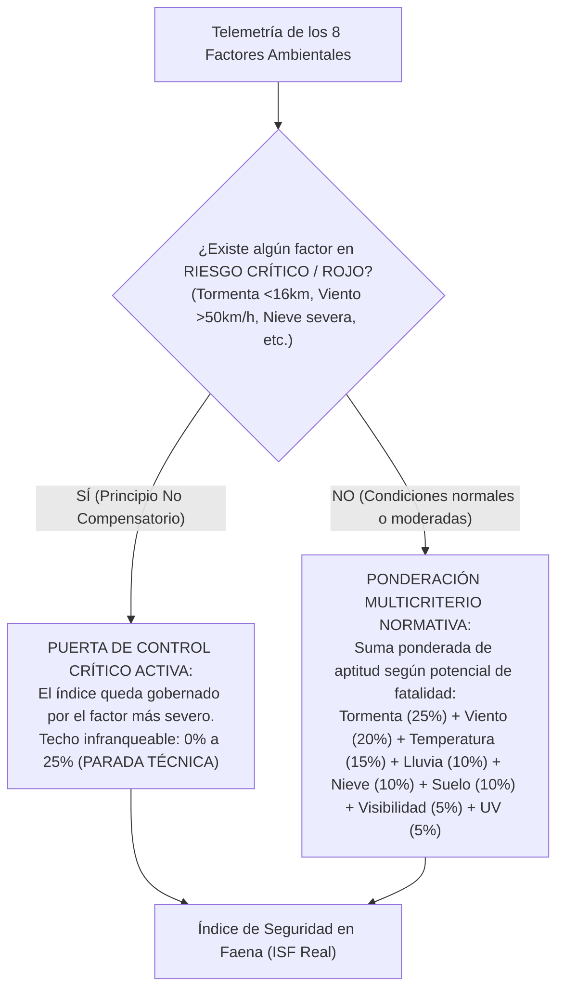

# MiEntorno

> Plataforma de monitoreo ambiental y evaluación predictiva de riesgos físicos en tiempo real para operaciones industriales, mineras, energéticas y de infraestructura a nivel global.

[](LICENSE)
[](#marco-normativo-y-regulatorio)
[](#arquitectura-tecnologica)

---

## 1. Descripción general

**MiEntorno** es un sistema de soporte a la toma de decisiones preventivas para supervisores de turno, inspectores de seguridad y salud en el trabajo (SST / HSE) e ingenieros residentes. Centraliza en una interfaz cartográfica satelital la telemetría climática y atmosférica en tiempo real para faenas operativas en cualquier coordenada geográfica del mundo (WGS84).

La herramienta calcula de manera continua un **Índice de seguridad en faena (ISF)** en escala porcentual ($0\%$ a $100\%$), proyecta el comportamiento de las condiciones en horizontes operativos de 30 minutos a 24 horas y emite recomendaciones de control operacional inmediatas fundamentadas en normas internacionales (ISO 7243, OMS, OMM / WMO, OSHA) y sectoriales (D.S. 024-2016-EM, R.M. 375-2008-TR).

---

## 2. Alcance operacional

La plataforma está diseñada para las siguientes actividades en campo:

- **Operaciones mineras a cielo abierto y superficie:** plataformas de perforación, tajos, botaderos, canteras y plantas concentradoras.
- **Proyectos de energía e infraestructura:** líneas de transmisión de alta tensión, subestaciones eléctricas, parques eólicos y presas hidroeléctricas.
- **Obras civiles y viales:** movimiento de tierras, andamiaje, encofrado y trabajos de pavimentación en altura geográfica.
- **Terminales portuarios y costeros:** patios de maniobra de contenedores, muelles y operación de grúas pórtico.
- **Operaciones en alta montaña y frentes fríos:** control de escarcha, isoterma 0°C y estabilidad de accesos.

---

## 3. Marco normativo y regulatorio

Los algoritmos de cálculo, umbrales de alerta y medidas de contingencia implementados en MiEntorno están calibrados conforme a los siguientes estándares:

| Norma / Estándar | Ámbito de aplicación | Factor evaluado en el sistema |
| :--- | :--- | :--- |
| **D.S. 024-2016-EM** (Arts. 136, 137, 271, 385) | Seguridad y Salud Ocupacional en Minería | Límite obligatorio de parada técnica para izajes y grúas móviles por ráfagas de viento ($\ge 32\text{ km/h}$). Protocolo de refugio ante tormentas eléctricas. |
| **Ley 30102 / OMS (WHO)** | Prevención contra radiación solar ultravioleta | Clasificación estandarizada del índice UV (escala global OMS de 0 a 16+) y obligatoriedad de fotoprotección, rotación a sombra y cubrenucas. |
| **ISO 7243 / R.M. 375-2008-TR** | Ergonomía y estrés térmico en el trabajo | Criterios de confort térmico, regímenes de hidratación (500 ml/h) y pausas obligatorias por calor severo o temperaturas bajo cero. |
| **Organización Meteorológica Mundial (OMM / WMO)** | Clasificación de inestabilidad convectiva | Gradiente de energía potencial convectiva disponible (CAPE en $\text{J/kg}$) y protocolo 30/30 para evacuación inmediata a refugios jaula de Faraday. |
| **ASME B30.5 / OSHA 1926.1431** | Estándar internacional de grúas e izaje | Criterios de reducción y parada de maniobras de carga por viento en pluma ($80\text{ m}$). |

---

## 4. Metodología de cálculo: Índice de seguridad en faena (ISF)

El índice general consolida el riesgo ambiental instantáneo y proyectado en una métrica porcentual entre $0.0\%$ y $100.0\%$. A diferencia de fórmulas empíricas basadas en deducciones aritméticas lineales ciegas (que pueden ocultar un peligro de muerte si los demás factores están en calma), MiEntorno implementa un **modelo riguroso de dos capas** sustentado en la **Gestión de Riesgos Críticos (CRM / ICMM)**, el **Reglamento de Seguridad y Salud Ocupacional en Minería (D.S. 024-2016-EM)** y la **Ley N° 29783**:

### Principio No Compensatorio en SST
En la prevención de fatalidades, la seguridad **no es compensatoria**. La ausencia de lluvia o la serenidad del viento no pueden compensar ni diluir una tormenta eléctrica activa con descargas a 4 km o ráfagas huracanadas sobre una grúa. Si un factor alcanza un nivel crítico de fatalidad, gobierna inmediatamente el índice general imponiendo un techo técnico y activando la parada técnica obligatoria.

### Formulación matemática en 2 Capas

$$\text{ISF} = \min\left( \sum_{i=1}^{8} W_i \times A_i, \; C_{\max}(\text{Severidad}_{\max}) \right)$$

Donde:
- $W_i$ es el **peso específico operacional** asignado a cada factor según su potencial de fatalidad ($\sum W_i = 100\%$).
- $A_i$ es la **aptitud porcentual del subfactor** ($100\%$ en condición normal, $85\%$ en alerta baja, $65\%$ moderada, $40\%$ restricción, $15\%$ severa y $0\%$ en parada técnica).
- $C_{\max}$ es la **Puerta de Control Crítico (*Non-compensatory Gate*)** impuesta por la severidad máxima presente en faena.



### Matriz de ponderación multicriterio ($W_i$)

| Factor ambiental y operativo | Peso ($W_i$) | Justificación técnica y normativa SST |
| :--- | :---: | :--- |
| **04. Tormenta eléctrica** | **25%** | Máximo potencial de fatalidad inmediata por caída de rayos a cielo abierto (D.S. 024-2016-EM). |
| **03. Viento y ráfagas** | **20%** | Riesgo catastrófico inmediato en izajes con grúas (ASME B30.5) y trabajos en altura (Norma G.050). |
| **05. Temperatura y estrés térmico** | **15%** | Riesgo vital por hipotermia severa ($\le -5^\circ	ext{C}$) o golpe de calor mortal ($\ge 38^\circ	ext{C}$, ISO 7243 / R.M. 375). |
| **02. Precipitación pluvial** | **10%** | Pérdida de adherencia, derrape de volquetes en haul roads e inundación en fondo de tajo. |
| **06. Nieve y congelamiento** | **10%** | Pérdida total de tracción en alta montaña y congelamiento de mecanismos hidráulicos. |
| **08. Humedad de suelo** | **10%** | Inestabilidad geotécnica de taludes, coronación de bancos y asentamiento de grúas móviles. |
| **07. Visibilidad en ruta** | **5%** | Riesgo de colisión de camiones de acarreo por niebla densa o polvaredas en rampas. |
| **01. Radiación solar UV** | **5%** | Riesgo ergonómico y ocupacional acumulativo sobre piel y ojos (Ley N° 30102). |

### Escala de acción operacional y techos críticos ($C_{\max}$)

| Severidad máxima | Rango ISF | Condición en faena | Criterio de acción en faena |
| :---: | :---: | :--- | :--- |
| **Nivel 0 – 2** | **$\ge 80.0\%$** | **Condición normal (Verde)** | Operaciones regulares sin restricciones climáticas adicionales. |
| **Nivel 3** | **$60.0\%$ a $79.9\%$** | **Atención requerida (Amarilla)** | Operación con controles preventivos: uso obligatorio de dos vientos guía (taglines) en izajes, cortavientos y rotación a la sombra. |
| **Nivel 4** | **$40.0\%$ a $59.9\%$** | **Operación restringida (Naranja)** | Suspensión de tareas en frentes expuestos: parada de izajes con grúas (vientos $> 38	ext{ km/h}$), restricción en rampas resbaladizas y repliegue de crestas. |
| **Nivel 5** | **$< 40.0\%$ ($C_{\max} \le 25\%$)** | **Alerta crítica / Parada obligatoria (Roja)** | **Parada técnica obligatoria inmediata** y evacuación a zonas seguras (refugios Faraday certificados ante tormentas $< 16	ext{ km}$, paralización total de grúas y andamios por viento $\ge 50	ext{ km/h}$ o nieve severa). |

---

## 5. Horizontes operativos y fiabilidad estadística del modelo

La plataforma cuenta con un selector de horizontes temporales que permite planificar el trabajo según la naturaleza de la maniobra, mostrando un indicador dinámico de fiabilidad en la cabecera:

| Horizonte | Fiabilidad | Técnica meteorológica | Aplicación táctica SST |
| :--- | :---: | :--- | :--- |
| **En vivo (0h)** | **98%** | Telemetría instantánea y Nowcasting OMM | Monitoreo en tiempo real de frentes activos en faena. |
| **30 minutos (30m)** | **95%** | Alta resolución cada 15 min (`minutely_15`) | Maniobras críticas de izaje y traslados de carga sobredimensionada. |
| **1 hora (1h)** | **92%** | Nowcasting táctico de corto plazo | Trabajos temporales en altura (andamios) y frentes expuestos. |
| **3 horas (3h)** | **88%** | Previsión de frentes dinámicos (HRRR / ICON) | Tareas programadas: vaciados de concreto, tendido y barrenación. |
| **9 horas (9h)** | **82%** | Jornada laboral diurna (ECMWF IFS) | Planificación de frentes de superficie en obras civiles. |
| **12 horas (12h)** | **78%** | Turno estándar de guardia (régimen 12x12) | Análisis Seguro de Trabajo (AST). Frentes de viento y ciclo térmico. |
| **24 horas (24h)** | **72%** | Ciclo circadiano y relevo diario | Planificación logística, relevo de guardias y previsión del día siguiente. |

---

## 6. Arquitectura tecnológica

MiEntorno ha sido concebido bajo un principio de **arquitectura desacoplada, ligera y auditable** sin dependencias complejas de compilación:

- **Frontend:** HTML5 semántico, CSS3 moderno (Custom Properties, Grid, Flexbox, backdrop-filter nativo) y ECMAScript Modules (ESM).
- **Cartografía interactiva:** Leaflet v1.9 con mosaicos satelitales de alta resolución de Esri World Imagery (`ArcGIS REST Services`) y capa de referencia cartográfica híbrida.
- **Telemetría meteorológica:** Integración directa con los modelos numéricos de alta resolución de [Open-Meteo](https://open-meteo.com) (GFS, ECMWF e ICON), consultando variables horarias de radiación solar, viento a 10 metros, ráfagas, probabilidad de lluvia y energía convectiva CAPE.
- **Geocodificación y búsqueda:** OpenStreetMap Nominatim con control estricto de tasa (*rate limit* de 1 segundo) para localización precisa de minas, puertos y ciudades en el mundo.
- **Geolocalización:** W3C Geolocation API con soporte de alta precisión (`enableHighAccuracy`) y monitoreo de dispersión satelital (alerta de precisión $> 500\text{ m}$).

---

## 7. Ejecución en entorno local

Al no requerir ningún paso de compilación o empaquetado (*zero build step*), el proyecto puede ejecutarse con cualquier servidor HTTP local:

### Con Python (3.x):
```bash
python3 -m http.server 8000
```
Luego abrir `http://localhost:8000` en su navegador web.

### Con Node.js (npx):
```bash
npx serve .
```

### Con PHP:
```bash
php -S localhost:8000
```

---

## 8. Autoría técnica

**Esai Josue Huaman Meza**  
- Ingeniero HSE

---
